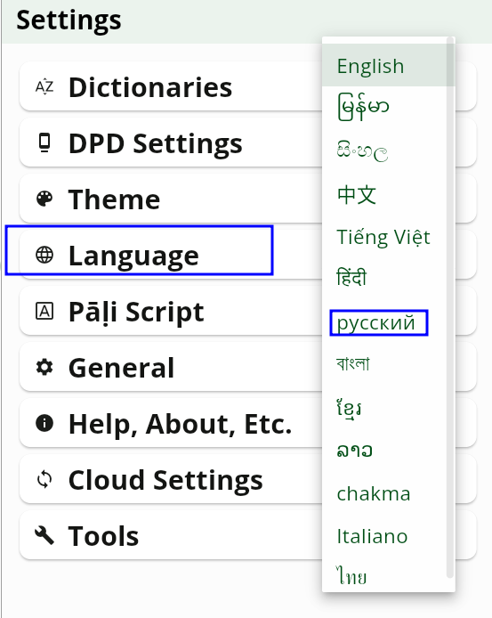
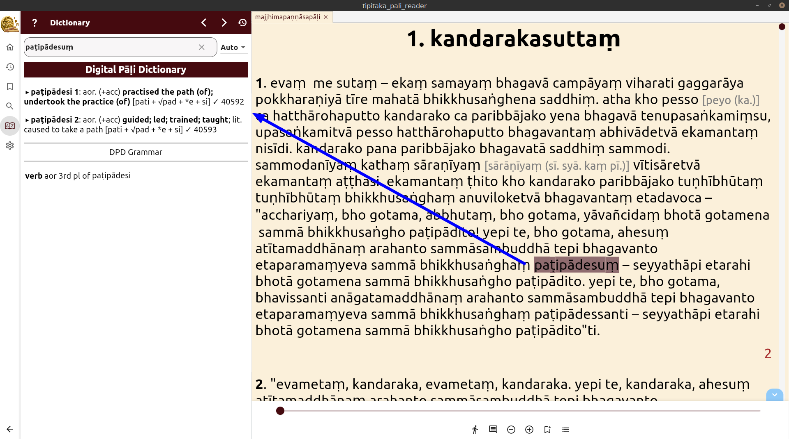
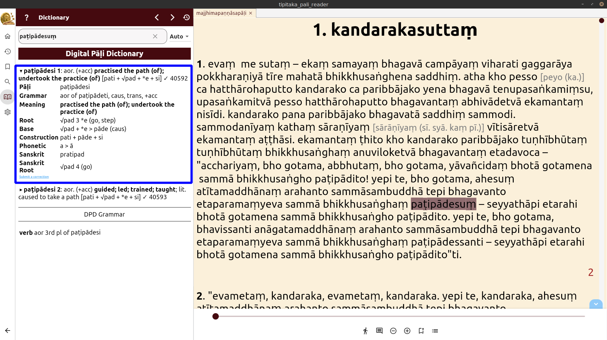
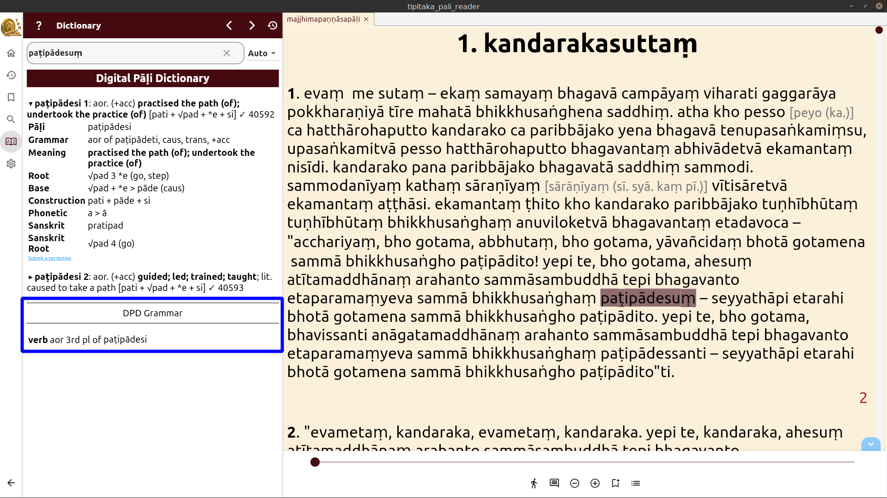

# Tipitaka Pali Reader

**Tipitaka Pali Reader** - отличное новое приложение для чтения Палийских текстов, разрабатываемое [Дост. Субхути](https://americanmonk.org/) и Дост. Паньяджаджа в Мьянме. Дополнительную информацию о TPR можно найти на [этом веб-сайте](https://americanmonk.org/tipitaka-pali-reader/).

TPR доступен для всех операционных систем и устройств. Загрузите последнюю версию для Windows, Mac, Linux, iOS и Android с [этой страницы на GitHub](https://github.com/bksubhuti/tipitaka-pali-reader/releases).

Существует поддержка русского языка.

Версия DPD встроена в Tipitaka Pali Reader.

Чтобы открыть слово в словаре, просто щелкните по нему, и откроется словарь. TPR использует ту же систему для распознавания измененных форм и сандхи, что и DPD, поэтому будут отображены только правильные возможности.

Чтобы увидеть подробную грамматическую информацию, щелкните по маленькой стрелке на записи в словаре, и появится больше информации.

Грамматический словарь DPD также включен для отображения возможных склонений и спряжений слова.

## Обновления

Каждый новый релиз TPR включает недавнюю версию DPD. Чтобы получить более свежие данные DPD, обновите TPR до последнего релиза.
